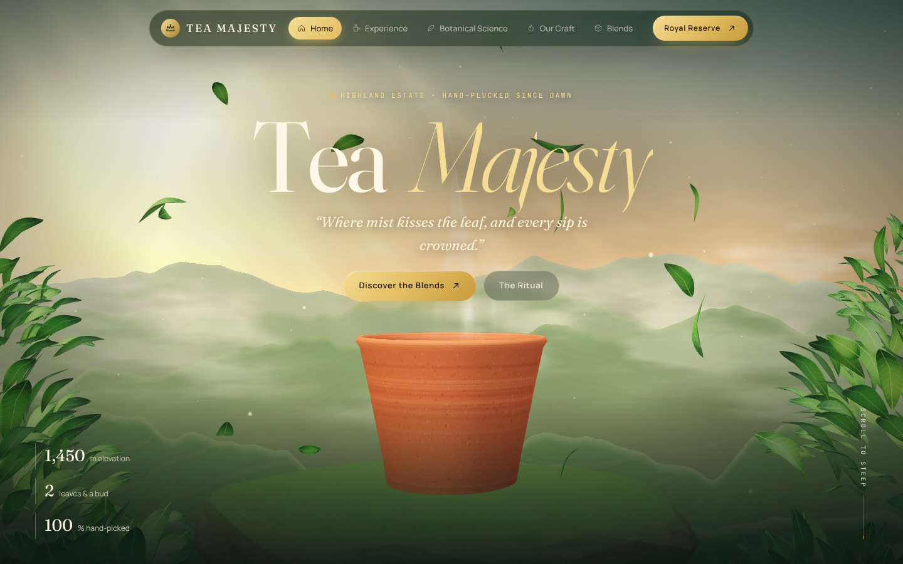

# Tea Majesty 3D



An immersive, scroll-driven 3D website for **Tea Majesty**, a royal highland tea brand.

Everything in the 3D world is generated in code (no downloaded models or photos): a misty tea-estate landscape at golden hour, a hand-thrown clay kulhad with live steam, wind-blown tea leaves, a gold ribbon and drifting pollen.

## Sections

| Section | What happens |
| --- | --- |
| **Preloader** | A cup fills with tea while fonts and the scene warm up. |
| **Hero** | Cinematic camera glide from high above the estate down to the cup. Title letters rise in, leaves burst on the wind, the scene follows the mouse. |
| **The Experience** | Pinned. The landscape melts into a dark studio, leaves orbit the cup, a gold ribbon spirals around it and four sensory notes appear. |
| **Botanical Science** | Pinned with snapping. A tea sprig draws itself, and three benefit slides light up their matching benefit chips. |
| **Our Craft** | Horizontal scroll through the four steps (pluck, wither, roll, seal), each with its own small CSS animation. |
| **Blends** | Five blends with a tiltable, draggable 3D pouch, colour theme per blend, pack sizes and an animated price. |
| **Finale + footer** | The cup returns, with "Replay the cinematic" and the order button. |
| **Order modal** | Personal / Wholesale modes, live total, validation and a WhatsApp hand-off. |

Plus: Lenis smooth scrolling, a custom cursor, magnetic buttons, a sliding nav pill that tracks the active section, a mobile menu, and a `prefers-reduced-motion` fallback.

## Stack

- [Vite](https://vitejs.dev/) (vanilla JS, no framework)
- [Three.js](https://threejs.org/) with custom GLSL shaders
- [GSAP](https://gsap.com/) + ScrollTrigger
- [Lenis](https://lenis.darkroom.engineering/) smooth scroll

## Run it

```bash
npm install
npm run dev      # http://localhost:5173
npm run build    # production build in dist/
npm run preview  # serve the build
```

## Deploy

`.github/workflows/deploy.yml` builds and publishes to GitHub Pages on every push to `main`.
Turn it on once in **Settings → Pages → Build and deployment → Source: GitHub Actions**.
The site will be at `https://<user>.github.io/Tea-Majesty-3D/`.

## Customise

- Blends, prices, currency (`৳`), pack sizes and the WhatsApp number: `src/data/blends.js`
- 3D scene: `src/scene/World.js` (camera choreography is in `updateCamera`)
- Scroll animations: `src/main.js`
- Styles and colour tokens: `src/styles/main.css`

The order form has no backend yet. Submitting shows a success state; hook it up to an API or form service in `src/ui/modal.js`.
